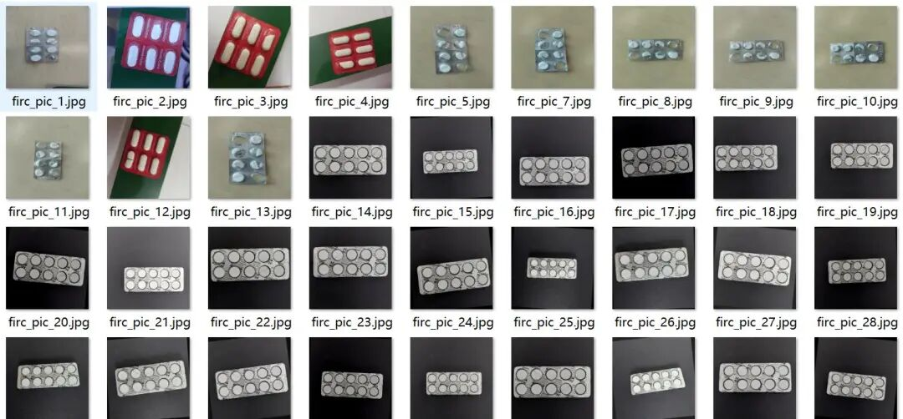
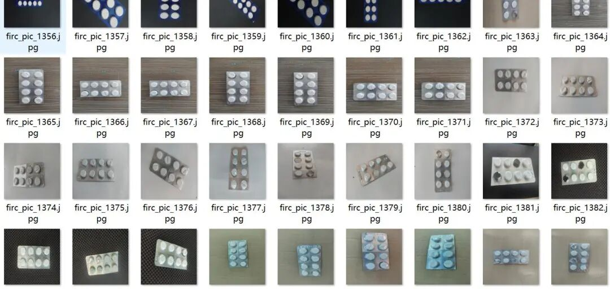
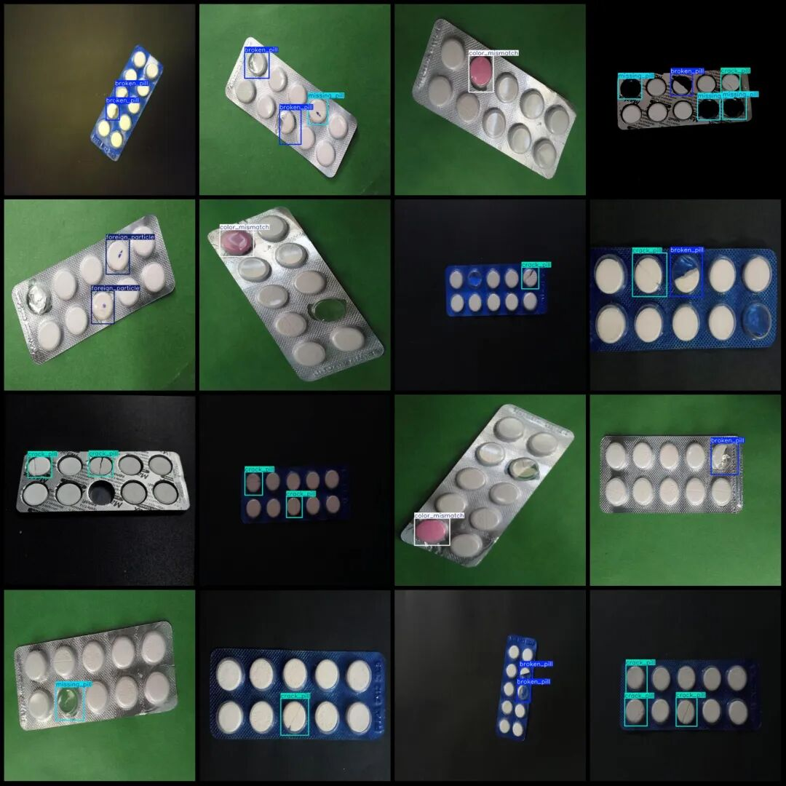
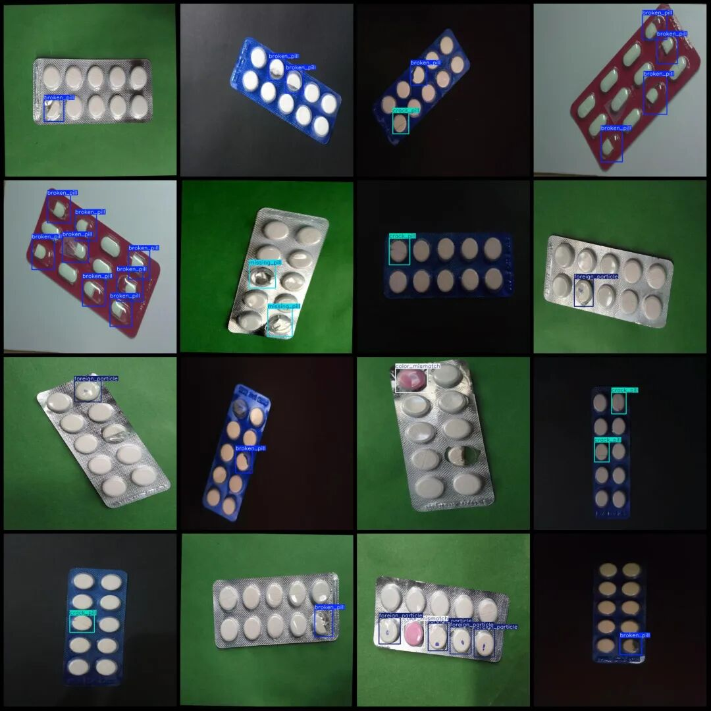

# Intelligent Medical Medication Spot the Cracks and Missing Defects Dataset in VOC+YOLO format with 1725 images across 5 categories

Dataset format: Pascal VOC format + YOLO format (txt file without split path, only contains jpg images and corresponding VOC format xml files and yolo format txt files)

Number of images (number of jpg files): 1725

Number of annotations (number of xml files): 1725

Number of annotations (number of txt files): 1725

Labeling category count: 5

Label category names (Note that the order of labels in the YOLO format does not correspond to this, but is based on the classes.txt file in the labels folder): ["broken_pill", "color_mismatch", "crack_pill", "foreign_particle", "missing_pill"]

Number of boxes labeled in each category:

Broken pill (pill damage) frame count = 1726

color_mismatch (color mismatch) frame count = 361

crack_pill (drug pill crack) frame count = 1044

foreign_particle ((Non-standard) Frame count = 280

missing_pill (Missing Pill) Frames = 343

Total frame count: 3754

Number of images per category:

broken_pill (drug pill damage) occupies a picture count = 788

color_mismatch (Color Mismatch) occupies 360 images.

crack_pill (drug pill crack) occupies the image count = 620

foreign_particle ((Non-standard) Ownership of images = 225

missing_pill (pill missing) occupies 151 images

Image resolution: 640x640

Using labelImg:

Annotation rules: Draw a rectangle around the category.

Important Notice: The dataset does not have separate training, validation, and test sets; you need to partition them yourself.

Special : This dataset does not guarantee the accuracy of the trained models or weight files.

Image Preview:

Annotation example:

## Payment

Here is a pay link on Stripe ( https://buy.stripe.com/3cs8yP7sY87d0vu9AB ). Please contact me lonlonago@foxmail.com after funding $89, and I will send you a complete data files , thank you!

